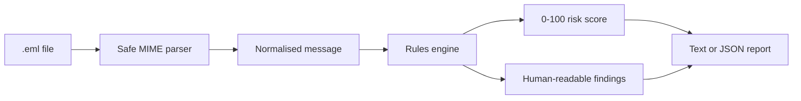
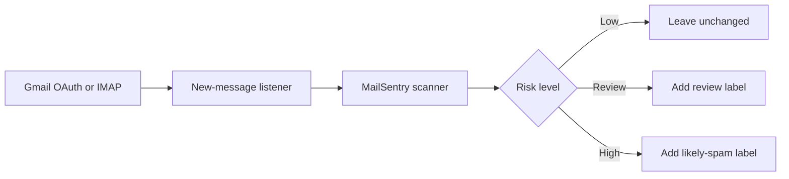

# MailSentry

[](https://github.com/Armoooo/mail-sentry/actions/workflows/ci.yml)
[](https://go.dev/)
[](LICENSE)

MailSentry is an explainable email risk analyser written in Go. It reads a
standard `.eml` email file, looks for common warning signs and produces a risk
score together with the reasons behind it.

The project answers a simple question:

> What looks suspicious about this email, and why?

MailSentry does not use a black-box model to make an unexplained spam decision.
Every result comes from visible, deterministic rules that can be tested,
reviewed and adjusted.

## Project status

MailSentry is currently an offline, read-only command-line application. It can
analyse saved emails from any company or email provider, but it does not yet
connect to a live Gmail, Outlook or IMAP inbox.

It never:

- clicks links or loads remote images;
- opens or executes attachments;
- deletes, moves or replies to email;
- sends message contents to a third party; or
- stores the body of an analysed message.

This makes the first version safe to develop and demonstrate before mailbox
access is added.

## How it works



1. The parser reads the sender, subject, text, HTML, links, authentication
   results and attachment names from the email.
2. The rules engine checks those values for suspicious patterns.
3. Each finding adds or subtracts a documented number of points.
4. The final score is limited to a range of 0-100 and assigned a risk level.
5. MailSentry prints the result and every reason that contributed to it.

For example, an email might claim to link to `paypal.com` while its button
actually points to an unrelated IP address. MailSentry reports the disguised
link, the IP-address destination and any other warning signs separately.

## What it checks

### Email authentication

- SPF failures
- DKIM failures
- DMARC failures
- A reduction in risk when all three checks pass

These results are read from the authentication headers added by the receiving
mail server. MailSentry does not perform its own DNS verification in the
current version.

### Sender identity

- Sender and Reply-To domains that do not match
- Sender and Return-Path domains that appear unrelated

### Links

- A visible web address that points to a different domain
- Links that use an IP address instead of a domain name
- Non-HTTPS links
- Common URL-shortening services that conceal the destination

### Attachments and content

- Potentially executable attachment extensions
- Urgent or threatening language
- Requests to verify passwords or account access
- Unexpected payment, prize or cryptocurrency language
- HTML email with no plain-text alternative

The checks are company-independent. MailSentry can therefore examine an email
claiming to come from any organisation, although it does not yet maintain a
directory of every company's official domains.

## Run the demo

Go 1.26 or later is required.

```sh
git clone https://github.com/Armoooo/mail-sentry.git
cd mail-sentry
go run ./cmd/mailsentry scan samples/suspicious.eml samples/legitimate.eml
```

Example output:

```text
samples/suspicious.eml
  From:    security@paypa1-support.example
  Subject: Final warning: immediate action required
  Result:  100/100 (high-risk)
  Findings:
    +30  DMARC authentication failed
    +20  SPF authentication failed
    +20  DKIM authentication failed
    +20  Reply-To domain differs from the sender domain
    +30  Displayed link domain differs from its destination
    +20  Message asks the recipient to verify credentials or account access
```

The repository includes one deliberately suspicious message and one legitimate
message. They use reserved example domains and a documentation-only IP address;
they do not contact real services.

### JSON output

Use JSON when integrating the scanner with another application:

```sh
go run ./cmd/mailsentry scan --format json samples/suspicious.eml
```

```json
[
  {
    "input": "samples/suspicious.eml",
    "from": "security@paypa1-support.example",
    "subject": "Final warning: immediate action required",
    "score": 100,
    "classification": "high-risk",
    "findings": [
      {
        "rule": "dmarc-failed",
        "points": 30,
        "description": "DMARC authentication failed"
      }
    ]
  }
]
```

### Standard input

Use `-` to analyse an email supplied through standard input:

```sh
cat message.eml | go run ./cmd/mailsentry scan -
```

MailSentry rejects messages larger than 10 MiB.

## Scoring rules

| Rule | Points |
| --- | ---: |
| DMARC failed | +30 |
| SPF failed | +20 |
| DKIM failed | +20 |
| SPF, DKIM and DMARC all passed | -15 |
| Reply-To domain differs from sender | +20 |
| Return-Path domain appears unrelated to sender | +15 |
| Displayed link disguises its destination | +30 |
| Link points directly to an IP address | +25 |
| Link uses a recognised URL shortener | +15 |
| Link does not use HTTPS | +10 |
| Potentially executable attachment | +35 |
| Credential or account-access request | +20 |
| Urgent or threatening language | +10 |
| Unexpected payment or prize language | +10 |
| HTML with no plain-text alternative | +5 |

The total is clamped to 0-100:

| Score | Classification | Meaning |
| ---: | --- | --- |
| 0-29 | `low-risk` | Few or no warning signs were found |
| 30-59 | `review` | The message deserves manual review |
| 60-79 | `likely-spam` | Several strong warning signs were found |
| 80-100 | `high-risk` | The message contains a high concentration of risk signals |

A score indicates risk, not certainty. A legitimate email can be configured
poorly, and a carefully constructed malicious email can avoid simple rules.

## Code structure

```text
cmd/mailsentry/       Command-line interface and output formatting
internal/message/     Size-limited email and MIME parsing
internal/scanner/     Risk rules, scoring and classifications
samples/              Safe demonstration email files
.github/workflows/    Automated vet, test and build checks
```

The implementation uses only the Go standard library. Keeping the dependency
surface small makes the security-sensitive parsing path easier to inspect.

## Build and test

```sh
make build
make check
```

`make check` runs `go vet` followed by the test suite with the race detector.
The compiled binary is written to `bin/mailsentry`.

The same checks run automatically in GitHub Actions on pushes and pull
requests to `main`.

## Known limitations

- MailSentry does not currently monitor a live mailbox.
- Authentication results are trusted from existing email headers rather than
  independently verified through DNS.
- Attachment names are checked, but attachment contents and archives are not
  scanned for malware.
- Link destinations are inspected as text; MailSentry does not visit them or
  query a reputation service.
- Language rules are currently English-only.
- The rules do not prove that an email is malicious and may produce false
  positives or false negatives.
- There is not yet a configurable list of trusted senders or official company
  domains.

These constraints are intentional for the first release and are kept explicit
so the tool is not mistaken for a complete enterprise email security product.

## Planned live-inbox workflow

The next major version will add a mailbox adapter while preserving the same
parser and rules engine:



The first integration will operate in dry-run or label-only mode. It will not
delete messages automatically. Gmail access will use OAuth rather than storing
the user's password.

## Roadmap

- Gmail integration using OAuth and label-only dry-run mode
- Provider-independent IMAP adapter
- Configurable trusted domains, allowlists and rule weights
- Feedback-driven Bayesian classification
- Review dashboard and screening metrics
- Attachment-content scanning through an isolated scanner
- Expanded test corpus and benchmark suite

## Privacy and security

Email files can contain private and highly sensitive information. Only analyse
files you are authorised to access, and avoid committing real messages to a
repository.

MailSentry processes messages locally and does not intentionally persist their
bodies. The included sample messages contain no genuine personal or company
data.

If you find a security problem in the project, please report it privately to
the maintainer rather than opening a public issue containing sensitive email
content.

## Licence

MailSentry is available under the [MIT Licence](LICENSE).
